  

  
  
  

### About me

I'm a Software Engineer at **xpln.ai**, where I build data pipelines orchestrated with **Apache Airflow**.
I graduated from **Télécom Paris** (Institut Polytechnique de Paris) with two specialisations: Data Science & AI, and Strategy & Economics.
Outside work I build AI agents that do real work within strict safety limits, and I run.

### Experience

| Role | Company | Dates |
|---|---|---|
| **Software Engineer** (full-time) | xpln.ai, Paris | Sep 2026 – present |
| **IS Analyst intern**, Business Solutions & Adoption | VINCI Construction IT, Paris | Jan – Jun 2026 |

At VINCI I owned a budget-control application: business requirements, technical specs and IT test strategy; adoption analytics with Piano Analytics, Microsoft Clarity and Power BI dashboards; level-3 production support with the development teams.

### Featured project

<table>
  <tr>
    <td valign="top">
      <h4><a href="https://github.com/IbaDemesy/runai-v2">RunAI v2</a>, race-trip assistant for runners</h4>
      
Describe the race you want. RunAI finds real races with official dates and distances, then, once you confirm the plan, <b>three browser agents</b> prepare registration, hotel and transport in parallel and stop before any payment. Started at the <b>Computer Use Agents Hackathon</b> (H Company x 42AI, Nov 2026).

           
    </td>
  </tr>
</table>

### Education

| Degree | School | Dates |
|---|---|---|
| **Master of Engineering** (Diplôme d'ingénieur), Data Science & Strategy/Economics | Télécom Paris, Institut Polytechnique de Paris | 2023 – 2026 |
| Exchange semester, Business & Economics | Tecnológico de Monterrey, Mexico | Aug – Dec 2025 |
| Classes préparatoires MPSI / MP\* | Lycée Chaptal, Paris | 2021 – 2023 |
| Baccalauréat, Mathematics, Physics & Computer Science | La Salle Passy Buzenval | 2021 |
| US High School Diploma (French-American Dual Diploma) | Dual Diploma, online | 2017 – 2021 |

School coursework (robot car, Java simulator, data analysis, econometrics, digital finance) is collected in [**telecom-paris-projects**](https://github.com/IbaDemesy/telecom-paris-projects).

**At school**
- **3rd prize, Swarm Rescue Challenge 2025-26** (CIEDS / AMIAD, Institut Polytechnique de Paris): programmed a fleet of 10 drones in Python to find and rescue injured people, robust to loss of localisation, communication or drones.
- **Vice-president, Télécom Paris sports club** (2024 – 2025): race director of the Ekiden du Platal, leading an 8-person team. 550 runners in 91 teams, 100+ volunteers, €20k budget.

### Tech stack

  

  
  
  
  
  
  

**Languages:** French (native) · English (C1) · Spanish (B1)
